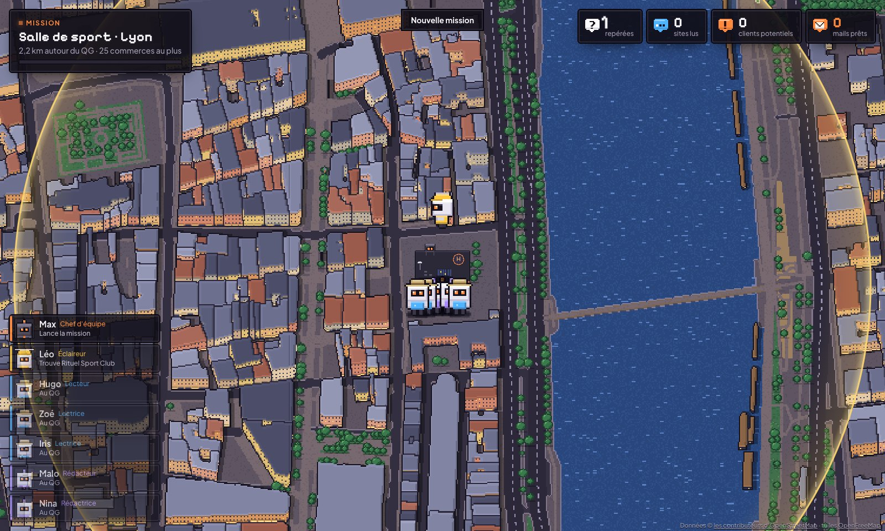
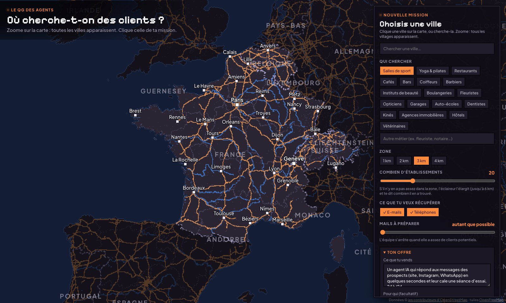
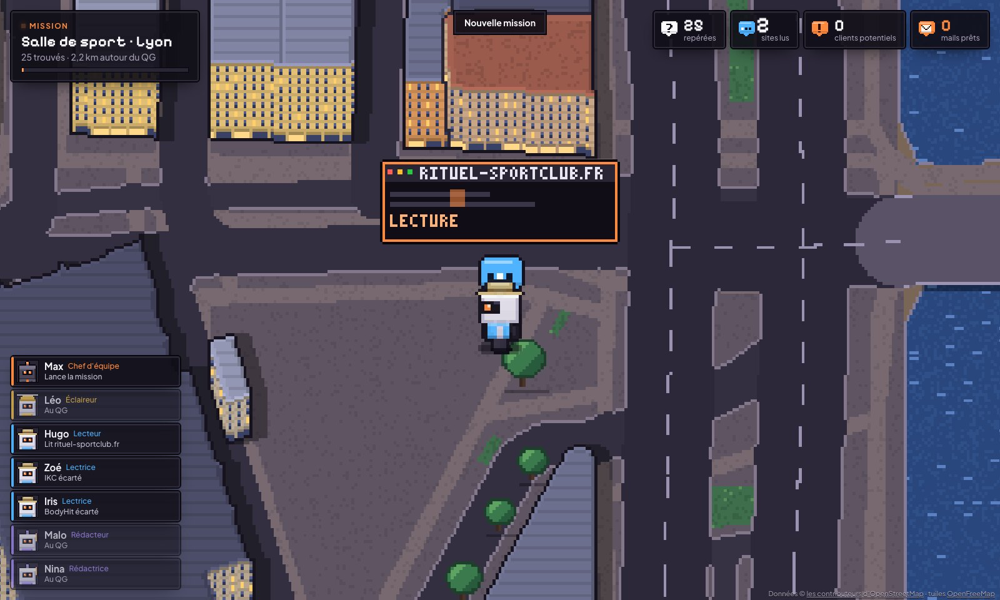
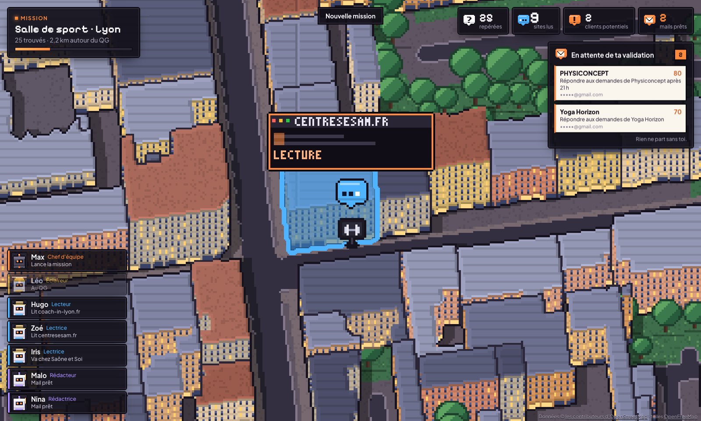

# Le QG des agents

**Une équipe d'agents IA qui cherche des clients dans une vraie ville. Tu regardes, tu valides.**

Tu choisis une ville sur la carte, un métier et ce que tu vends. Léo, l'éclaireur, scanne la ville et repère les commerces.
Hugo, Zoé et Iris, les lecteurs, vont voir chacun d'eux : ils lisent leur site, notent ce qui leur manque, relèvent l'e-mail
et le téléphone affichés. Malo et Nina, les rédacteurs, écrivent un premier mail avec ton offre et ce qu'ils ont vu.
Max, le chef, fait tourner l'équipe. Tout se joue sous tes yeux, dans la vraie ville en pixel art.

**Rien ne part tout seul : chaque mail attend ta validation.**



Gratuit, open source, et tout tourne sur ton ordinateur.

---

## L'installer en 2 minutes (sans savoir coder)

1. Il te faut [Claude Code](https://claude.com/claude-code), installé et connecté à ton compte.
2. Ouvre Claude Code et colle cette phrase :

   ```
   Installe et lance le QG des agents : https://github.com/devlikemasta/qg-des-agents
   ```

3. Claude Code télécharge le QG, l'installe, te dit s'il manque quelque chose, et l'ouvre dans ton navigateur
   (http://127.0.0.1:5577).

Les fois suivantes, dis simplement à Claude Code « Relance le QG des agents ».

> **Pour Claude Code** (si on t'a donné ce lien) :
> 1. Vérifie que Node.js 22.13 ou plus récent est installé (`node -v`). Sinon, propose à la personne de l'installer depuis https://nodejs.org (version LTS).
> 2. `git clone https://github.com/devlikemasta/qg-des-agents.git` dans le dossier de son choix (par défaut : son dossier personnel), puis `cd qg-des-agents` et `npm install`.
> 3. **Aucune clé n'est obligatoire.** Les commerces viennent d'OpenStreetMap (gratuit) et les mails sont écrits par Claude Code, avec l'abonnement de la personne. Explique-lui ça en une phrase.
> 4. Une seule clé est facultative : `GOOGLE_MAPS_API_KEY` (fiche Google de chaque commerce, recherche par Google Places). Demande-lui si elle la veut. Si oui : copie `.env.example` en `.env`, guide-la dans la Google Cloud Console (créer une clé, activer « Places API (New) », restreindre la clé à cette API) et fais-la coller dans `.env`. **Ne demande jamais qu'on te colle la clé dans la conversation**, et ne l'écris nulle part ailleurs que dans `.env`.
> 5. Demande-lui son offre en trois lignes (ce qu'elle vend, pour qui, sa signature et son site). Elle peut aussi la taper dans le panneau de lancement : c'est enregistré dans `config.json` (créé au premier lancement depuis `config.example.json`).
> 6. Lance `npm start` **en arrière-plan** : c'est un petit serveur qui doit rester allumé. Il ouvre le navigateur tout seul.
> 7. Dis-lui que le QG est prêt, qu'il tourne tant que la commande tourne, et qu'aucun mail ne part sans qu'elle le valide.

### À la main, si tu préfères

```bash
git clone https://github.com/devlikemasta/qg-des-agents.git
cd qg-des-agents
npm install
npm start
```

Il te faut [Node.js](https://nodejs.org) 22.13 ou plus récent, et [Claude Code](https://claude.com/claude-code) connecté
(les rédacteurs l'utilisent pour écrire les mails). Pour arrêter le QG : `Ctrl + C` dans le terminal.

## Ta première mission



1. **Choisis une ville.** Zoome sur la carte : les grandes villes, puis chaque village apparaissent. Clique celle que tu veux,
   ou cherche-la.
2. **Dis ce que tu cherches** : le métier (salles de sport, restaurants, coiffeurs… ou un autre), la zone (1 à 4 km) et
   combien d'établissements. S'il n'y en a pas assez dans la zone, l'éclaireur l'élargit (jusqu'à 6 km) et te dit combien il en a trouvé.
3. **Ce que tu veux récupérer** : leurs e-mails, leurs téléphones, et combien de mails préparer au plus.
4. **Ton offre et ton mail** : ce que tu vends, pour qui, ta signature, et tes consignes au rédacteur (ton, longueur…).
5. **Lance l'équipe.** La caméra plonge sur la ville, et tout se passe en direct.

Commence petit : une ville, un métier, 5 commerces.

## Ce que tu peux faire dedans

- **Cliquer un commerce trouvé** : sa fiche, avec ce qui lui manque (réservation en ligne, quelqu'un qui répond sur le site,
  WhatsApp…), ses contacts (l'e-mail et la page où il est affiché, les téléphones), la note sur 100 expliquée point par point,
  et le mail préparé, que tu peux corriger, **valider** ou **refuser**.
- **Cliquer n'importe quel autre commerce de la carte** : son nom, un lien Google Maps, et « Envoyer un lecteur » pour qu'un
  robot aille le voir pour de vrai.
- **Revoir une mission** : elle se rejoue à l'identique, sans relancer l'équipe ni consommer ton abonnement.
- **La version cinéma** : http://127.0.0.1:5577/?cinema rejoue ta plus grosse mission comme un film (titres, chapitres,
  ralentis, compteurs), parfait pour filmer ton écran.
- **N** : jour, soir, nuit · **R** : rejouer · molette et glisser : la caméra (elle reprend la main toute seule après 6 s).



## Ce qui se passe sur ton ordinateur

- **Tout reste chez toi.** Le serveur n'écoute que sur ton ordinateur (127.0.0.1). Les commerces, les notes et les mails sont
  rangés dans `data/agents.db` (SQLite), qui n'est jamais envoyé nulle part.
- **L'éclaireur** interroge OpenStreetMap (API Overpass, gratuite) une fois par mission, et garde la réponse 7 jours
  (`data/overpass`) : il ne redemande jamais la même chose. Les grandes chaînes sont écartées.
- **Les lecteurs** ouvrent seulement les pages publiques d'un site (accueil, contact, mentions légales, réservation) et notent
  ce qu'ils voient. La note est une règle lisible (`server/agents/lecteur.mjs`, fonction `noter`) : chaque point est expliqué.
- **Les rédacteurs** sont Claude Code en mode `claude -p` : **ça consomme ton abonnement Claude**, un appel par mail écrit.
  Pas de clé API.
- **Aucun mail ne part.** Ils attendent dans « En attente de ta validation ». L'envoi, c'est toi qui le fais, depuis ta boîte.



### Avant d'écrire à des commerces

Écris à l'adresse professionnelle que le commerce affiche lui-même, pour un sujet qui concerne son activité. Dis qui tu es,
laisse un moyen simple de dire non (chaque mail se termine par une ligne pour ça), et respecte-le. Pas de promesse de résultat.
Les règles dépendent de ton pays : en France, vérifie-les sur [cnil.fr](https://www.cnil.fr). Ce n'est pas un conseil juridique.

## Les clés : aucune n'est obligatoire

| Ce qu'il faut | Pour quoi | Où |
|---|---|---|
| Claude Code connecté | Les rédacteurs écrivent les mails | ton abonnement Claude |
| `GOOGLE_MAPS_API_KEY` (facultatif) | Retrouver la fiche Google de chaque commerce ; chercher avec Google Places (`"source": "google"` dans `config.json`) | `.env` (modèle : `.env.example`) |

Tes clés restent dans `.env`, ignoré par git. Ne les colle jamais dans une conversation ni dans un fichier suivi.

## L'améliorer

Ouvre Claude Code dans le dossier du QG et dis-lui ce que tu veux ajouter : un nouveau métier, une nouvelle règle de note, un
autre pays. Le fichier [CLAUDE.md](CLAUDE.md) lui explique comment le projet est fait.

- `npm run dev` : le serveur et l'interface avec rechargement à chaud (http://127.0.0.1:5577).
- `npm run build` : construit l'interface (`web/dist`). `npm start` la reconstruit toute seule si besoin.

## Merci

- **Les données** : © les contributeurs d'[OpenStreetMap](https://www.openstreetmap.org/copyright) (ODbL), tuiles vectorielles
  [OpenFreeMap](https://openfreemap.org), API [Overpass](https://overpass-api.de). Les villes de la recherche :
  [GeoNames](https://www.geonames.org) (CC BY 4.0). Les contours des pays : [Natural Earth](https://www.naturalearthdata.com)
  (domaine public), via `world-atlas`.
- **Les polices** : Pixelify Sans et Plus Jakarta Sans (licence OFL).
- **Le grand frère** : le [Bureau des agents](https://github.com/devlikemasta/bureau-des-agents), où les mêmes robots
  travaillent au bureau. Le code et les dessins du QG sont écrits à neuf, en pixel art, sans image externe.

Licence MIT (voir [LICENSE](LICENSE)). Un projet [VibesMoney](https://vibesmoney.com) : on t'apprend à créer des agents IA
qui travaillent pour toi.

---

## In English

**The Agents' HQ** is a team of AI agents that looks for clients in a real city, drawn in pixel art. Pick a city on the map,
a type of business and what you sell. The scout finds businesses on OpenStreetMap, readers open their websites and note what
is missing, writers draft a first email with your offer (Claude Code in `claude -p` mode, with your own subscription). **No
email is ever sent automatically**: every draft waits for your approval. Runs locally; no API key required (an optional
Google Maps key adds Google place links). Requirements: Node.js 22.13+ and Claude Code. Install: paste
`Install and run the Agents' HQ: https://github.com/devlikemasta/qg-des-agents` into Claude Code, or `git clone`,
`npm install`, `npm start`. The interface is in French for now.
